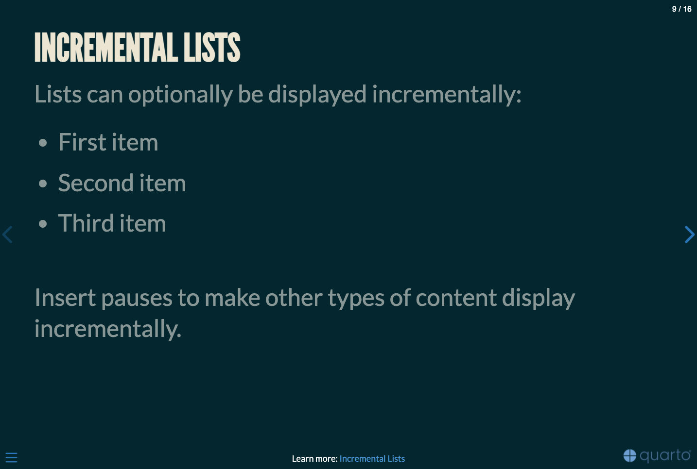
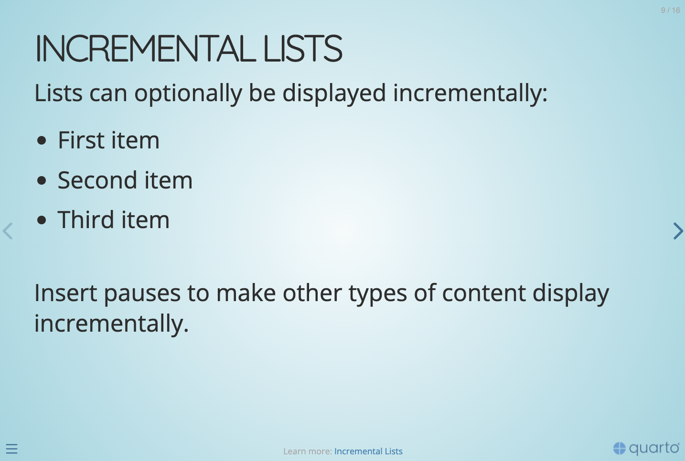
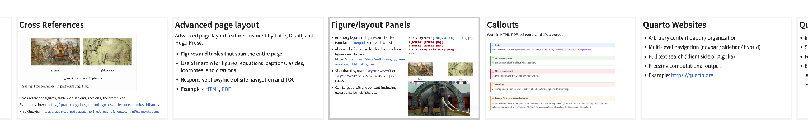
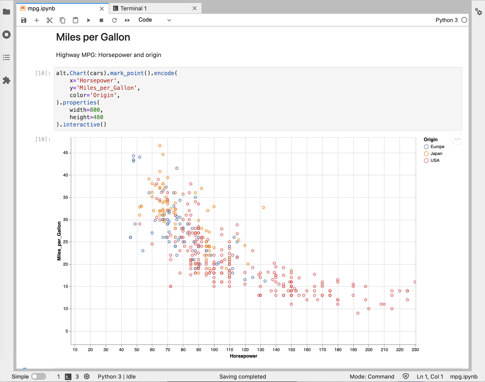
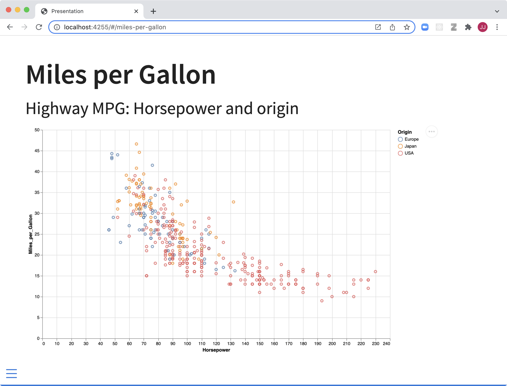
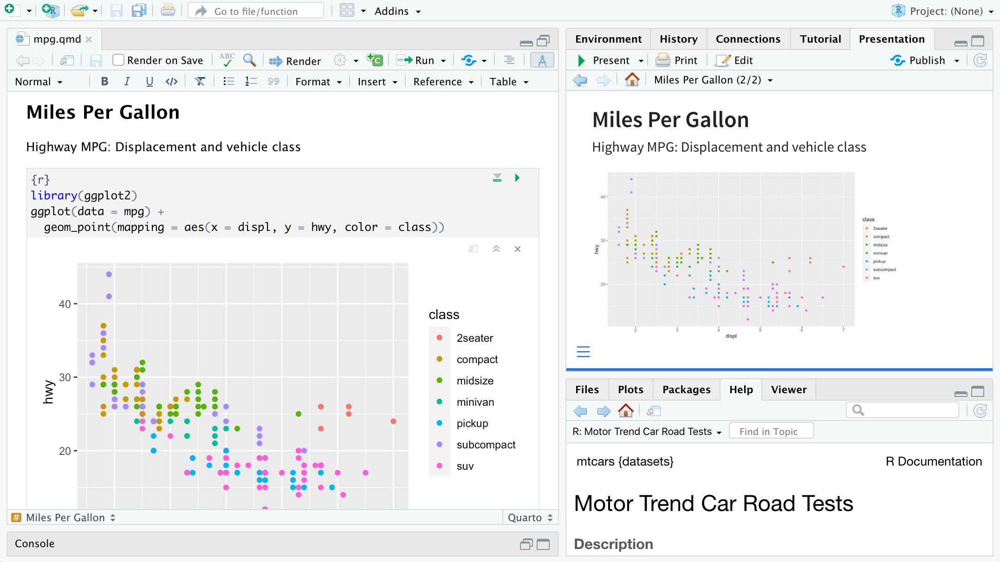

---
<<<<<<< HEAD
title: "Do the Data Fit Mendel?"
subtitle: "Using the &chi;^2^ test to evaluate genetic crosses"
author: "Example Student"
institute: "BIOL 110 · The Community College of Baltimore County"
format:
  revealjs:
    slide-number: true
    controls: true
    preview-links: auto
    css: styles.css
    include-in-header: pdf-export.html
    footer: "&chi;^2^ testing in genetics · BIOL 110 example presentation"
resources:
  - chisq.ipynb
---

## Why do we need a statistical test?

- Mendel's laws predict **ratios** of offspring, like 3:1 or 9:3:3:1
- Real crosses almost never match those ratios exactly
- So how far off is *too* far off?

. . .

The **chi-square (&chi;^2^) goodness-of-fit test** tells us whether the difference between what we **observed** and what we **expected** is small enough to be explained by chance.

::: notes
Open with the question, not the formula. Ask the audience: if you counted 78 tall and 22 short plants instead of 75 and 25, would you say Mendel was wrong? Pause for a moment before revealing the answer.
:::

## Background: where expected ratios come from

:::: {.columns}
::: {.column width="45%"}
A monohybrid cross of two heterozygotes (Pp &times; Pp):

|       | **P** | **p** |
|-------|:-----:|:-----:|
| **P** | PP    | Pp    |
| **p** | Pp    | pp    |

: Punnett square for Pp &times; Pp {tbl-colwidths="[20,40,40]"}
:::

::: {.column width="55%"}
- Genotypes: 1 PP : 2 Pp : 1 pp
- Phenotypes: **3 dominant : 1 recessive**
- A dihybrid cross (PpSs &times; PpSs) gives **9 : 3 : 3 : 1**
- These ratios were first reported by Mendel (1866)
:::
::::

::: notes
Briefly connect to the Punnett squares the class completed in Lab 11. Emphasize that the Punnett square gives probabilities, so the observed counts will vary around them.
:::

## Hypotheses

Every &chi;^2^ test starts with two competing statements:

- **Null hypothesis** ($H_0$): the observed counts fit the expected Mendelian ratio; any differences are due to random chance.
- **Alternative hypothesis** ($H_1$): the observed counts do **not** fit the expected ratio.

. . .

We choose a significance level before looking at the data: $\alpha = 0.05$.

::: notes
Stress that the test is built around the null hypothesis. We never "prove" the null; we either reject it or fail to reject it.
:::

## The &chi;^2^ statistic

$$
\chi^2 = \sum_{i=1}^{k} \frac{(O_i - E_i)^2}{E_i}
$$

- $O_i$ = observed count in category $i$
- $E_i$ = expected count in category $i$ = total $\times$ expected proportion
- $k$ = number of categories

. . .

Degrees of freedom: $df = k - 1$

::: notes
Walk through each piece of the formula. Squaring removes negative signs; dividing by E scales each difference relative to what we expected. Introduced by Pearson (1900).
:::

## Critical values {.critical-values}

If $\chi^2$ is greater than the critical value, we **reject** $H_0$.

::: {.smallfont}

:::

::: aside
Critical values at $\alpha = 0.05$, computed in R with `qchisq()`. These match the table in Chapter 11 of the lab manual.
:::

::: notes
Point out that students do not need to memorize these; R or a table provides them. Highlight 3.84 for df = 1 and 7.81 for df = 3, the two values used in the lab.
:::

## Example 1: monohybrid cross (3:1) {.smaller .larger-code}

Data from the Chapter 11 worked example: 78 tall and 22 short plants.



. . .



::: notes
Show that the hand calculation in the lab manual and R agree: 0.12 + 0.36 = 0.48. With df = 1, 0.48 is well below 3.84, and the p-value (0.49) is far above 0.05.
:::

## Example 1: interpretation

- $\chi^2 = 0.48 < 3.84$ (critical value, $df = 1$)
- $p = 0.49 > 0.05$

. . .

**Conclusion:** we **fail to reject** $H_0$. The data are consistent with a 3:1 ratio; the small differences are likely due to chance.

::: notes
Model the exact wording students should use in their own lab reports.
:::

## Example 2: dihybrid cross (9:3:3:1) {.smaller .larger-code}

Data from the Chapter 11 worked example: 320 seeds.



::: notes
Ask the audience which category contributes most to chi-square. Wrinkled yellow contributes 6.67 of the 8.89 total.
:::

## Example 2: the test



- $\chi^2 = 8.89$ with $df = 4 - 1 = 3$
- $p = 0.03$, which is less than 0.05

::: aside
The lab manual reports 8.90 because each term was rounded before adding. Rounding only at the end gives 8.89; the conclusion is the same.
:::

::: notes
Compare R's result to the hand calculation in the lab manual and explain the small rounding difference. Good practice: keep full precision until the final step.
:::

## Observed vs. expected {.observed-expected}



Wrinkled yellow seeds (40 observed vs. 60 expected) account for most of the &chi;^2^ value.

::: notes
A figure makes the mismatch visible immediately. Every figure in a presentation should have a clear purpose and labeled axes.
:::

## Where does our result fall?



$\chi^2 = 8.89 > 7.81$, so we **reject** $H_0$: the data do not fit a 9:3:3:1 ratio.

::: notes
The shaded area is the 5% rejection region for df = 3. Our statistic falls inside it. Possible biological explanations: linked genes, reduced survival of one phenotype, or counting errors.
:::

## Human connection: MN blood groups

- The M and N blood-group alleles are **codominant**, so all three genotypes (MM, MN, NN) can be identified from a blood test
- Under **Hardy–Weinberg equilibrium** (Hardy, 1908), genotype frequencies are $p^2 : 2pq : q^2$, where $p$ and $q$ are the allele frequencies
- Data: genotypes of 1,279 people in England (Race & Sanger, 1975)

::: notes
This applies the same test to human genetics. Here the expected values come from the population's own allele frequencies instead of a Punnett square.
:::

## Expected MN genotypes {.smaller .larger-code .mn-genotypes}



::: notes
Walk through the allele frequency calculation: each MM person carries two M alleles and each MN person carries one.
:::

## Human connection: result



- $df = 3 - 1 - 1 = 1$, because one extra value ($p$) was **estimated from the data**
- $\chi^2 = 0.027 < 3.84$, $p = 0.87$: we **fail to reject** $H_0$

The population's MN genotypes are consistent with Hardy–Weinberg equilibrium.

::: notes
Point out the degrees-of-freedom subtlety: we lose one df for each parameter estimated from the data. That's why chisq.test's default df would be wrong here, so the p-value was computed with pchisq.
:::

## Limitations

- &chi;^2^ needs **counts**, not percentages or measurements
- Each expected count should be **at least 5**
- Failing to reject $H_0$ does **not prove** the hypothesis is true
- A fit can even be *too* good: Fisher (1936) argued that Mendel's published data matched expectations more closely than chance would predict

::: notes
End the body of the talk with critical thinking. The Fisher anecdote shows that statistics can be used to evaluate the reliability of data, not only hypotheses.
:::

## Conclusion

- Genetics predicts **expected ratios**; real data vary by chance
- &chi;^2^ tells us if the variation is larger than chance would produce
- Compare $\chi^2$ to the critical value and state a conclusion about $H_0$
- The same test works for plants and human populations

**Your turn:** apply the test to the corn-ear counts you collected in Lab 11.

::: notes
Summarize in three to four points and finish with a clear call to action that connects back to the lab.
:::

## References {.smaller}

::: {style="font-size: 0.8em;"}
Fisher, R. A. (1936). Has Mendel's work been rediscovered? *Annals of Science, 1*(2), 115–137. <https://doi.org/10.1080/00033793600200111>

Hardy, G. H. (1908). Mendelian proportions in a mixed population. *Science, 28*(706), 49–50. <https://doi.org/10.1126/science.28.706.49>

Mateja, G. (2026). Mendelian genetics in corn and chi-square testing. In *Introduction to human biology laboratory workbook* (Chapter 11). The Community College of Baltimore County.

Mendel, G. (1866). Versuche über Pflanzen-Hybriden. *Verhandlungen des naturforschenden Vereines in Brünn, 4*, 3–47.

Pearson, K. (1900). On the criterion that a given system of deviations from the probable in the case of a correlated system of variables is such that it can be reasonably supposed to have arisen from random sampling. *Philosophical Magazine, Series 5, 50*(302), 157–175. <https://doi.org/10.1080/14786440009463897>

Race, R. R., & Sanger, R. (1975). *Blood groups in man* (6th ed.). Blackwell Scientific.

R analysis: [chisq.ipynb](chisq.ipynb)
=======
title: "Quarto Presentations"
subtitle: "Create beautiful interactive slide decks with Reveal.js"
format:
  revealjs:
    slide-number: true
    chalkboard:
      buttons: false
    preview-links: auto
    logo: images/quarto.png
    css: styles.css
    footer: '[https://quarto.org](https://quarto.org)'
    include-after-body: date.html
resources:
  - demo.pdf
revealjs-plugins:
  - editable
filters:
  - editable
---

::: {.absolute width="204px" height="102px" left="448.2px" top="271.6px"}
Year+Day
:::

## New Slide



## New Slide

::: {.absolute width="204px" height="102px" left="113px" top="184.9px"}
New text
:::

## Hello, There

This presentation will show you examples of what you can do with Quarto and [Reveal.js](https://revealjs.com), including:

- Presenting code and LaTeX equations
- Including computations in slide output
- Image, video, and iframe backgrounds
- Fancy transitions and animations
- Activating scroll view

...and much more

## Pretty Code {auto-animate="true"}

- Over 20 syntax highlighting themes available
- Default theme optimized for accessibility

``` r
# Define a server for the Shiny app
function(input, output) {

  # Fill in the spot we created for a plot
  output$phonePlot <- renderPlot({
    # Render a barplot
  })
}
```

::: footer
Learn more: [Syntax Highlighting](https://quarto.org/docs/output-formats/html-code.html#highlighting)
:::

## Code Animations {auto-animate="true"}

- Over 20 syntax highlighting themes available
- Default theme optimized for accessibility

``` r
# Define a server for the Shiny app
function(input, output) {
  
  # Fill in the spot we created for a plot
  output$phonePlot <- renderPlot({
    # Render a barplot
    barplot(WorldPhones[,input$region]*1000, 
            main=input$region,
            ylab="Number of Telephones",
            xlab="Year")
  })
}
```

::: footer
Learn more: [Code Animations](https://quarto.org/docs/presentations/revealjs/advanced.html#code-animations)
:::

## Line Highlighting

- Highlight specific lines for emphasis
- Incrementally highlight additional lines

``` {.python code-line-numbers="4-5|7|10"}
import numpy as np
import matplotlib.pyplot as plt

r = np.arange(0, 2, 0.01)
theta = 2 * np.pi * r
fig, ax = plt.subplots(subplot_kw={'projection': 'polar'})
ax.plot(theta, r)
ax.set_rticks([0.5, 1, 1.5, 2])
ax.grid(True)
plt.show()
```

::: footer
Learn more: [Line Highlighting](https://quarto.org/docs/presentations/revealjs/#line-highlighting)
:::

## Executable Code

```{r}
#| echo: true
#| fig-width: 10
#| fig-height: 4.5
library(ggplot2)
ggplot(mtcars, aes(hp, mpg, color = am)) +
  geom_point() +
  geom_smooth(formula = y ~ x, method = "loess")
```

::: footer
Learn more: [Executable Code](https://quarto.org/docs/presentations/revealjs/#executable-code)
:::

## LaTeX Equations

[MathJax](https://www.mathjax.org/) rendering of equations to HTML

::::: columns
::: {.column width="40%"}
``` tex
\begin{gather*}
a_1=b_1+c_1\\
a_2=b_2+c_2-d_2+e_2
\end{gather*}

\begin{align}
a_{11}& =b_{11}&
  a_{12}& =b_{12}\\
a_{21}& =b_{21}&
  a_{22}& =b_{22}+c_{22}
\end{align}
```
:::

::: {.column width="60%"}
\begin{gather*}
a_1=b_1+c_1\\
a_2=b_2+c_2-d_2+e_2
\end{gather*} \begin{align}
a_{11}& =b_{11}&
  a_{12}& =b_{12}\\
a_{21}& =b_{21}&
  a_{22}& =b_{22}+c_{22}
\end{align}
:::
:::::

::: footer
Learn more: [LaTeX Equations](https://quarto.org/docs/authoring/markdown-basics.html#equations)
:::

## Column Layout {.smaller}

Arrange content into columns of varying widths:

:::::: columns
::: {.column width="35%"}
#### Motor Trend Car Road Tests

The data was extracted from the 1974 Motor Trend US magazine, and comprises fuel consumption and 10 aspects of automobile design and performance for 32 automobiles.
:::

::: {.column width="3%"}
:::

::: {.column width="62%"}
```{r}
knitr::kable(head(mtcars)[,c("mpg",	"cyl", "disp", "hp", "wt")])
```
:::
::::::

::: footer
Learn more: [Multiple Columns](https://quarto.org/docs/presentations/revealjs/#multiple-columns)
:::

## Incremental Lists

Lists can optionally be displayed incrementally:

::: incremental
- First item
- Second item
- Third item
:::

. . .

<br/> Insert pauses to make other types of content display incrementally.

::: footer
Learn more: [Incremental Lists](https://quarto.org/docs/presentations/revealjs/#incremental-lists)
:::

## Fragments

Incremental text display and animation with fragments:

<br/>

::: {.fragment .fade-in}
Fade in
:::

::: {.fragment .fade-up}
Slide up while fading in
:::

::: {.fragment .fade-left}
Slide left while fading in
:::

::: {.fragment .fade-in-then-semi-out}
Fade in then semi out
:::

. . .

::: {.fragment .strike}
Strike
:::

::: {.fragment .highlight-red}
Highlight red
:::

::: footer
Learn more: [Fragments](https://quarto.org/docs/presentations/revealjs/advanced.html#fragments)
:::

## Slide Backgrounds {background="#43464B"}

Set the `background` attribute on a slide to change the background color (all CSS color formats are supported).

Different background transitions are available via the `background-transition` option.

::: footer
Learn more: [Slide Backgrounds](https://quarto.org/docs/presentations/revealjs/#color-backgrounds)
:::

## Media Backgrounds {background="#43464B" background-image="images/milky-way.jpeg"}

You can also use the following as a slide background:

- An image: `background-image`

- A video: `background-video`

- An iframe: `background-iframe`

::: footer
Learn more: [Media Backgrounds](https://quarto.org/docs/presentations/revealjs/#image-backgrounds)
:::

## Absolute Position

Position images or other elements at precise locations

{.absolute .editable top="170" left="30" width="400" height="400"}

{.absolute .fragment .editable top="150" right="80" width="450"}

{.absolute .fragment .editable bottom="110" right="130" width="300"}

::: footer
Learn more: [Absolute Position](https://quarto.org/docs/presentations/revealjs/advanced.html#absolute-position)
:::

## Auto-Animate {auto-animate="true" auto-animate-easing="ease-in-out"}

Automatically animate matching elements across slides with Auto-Animate.

:::::: r-hstack
::: {data-id="box1" auto-animate-delay="0" style="background: #2780e3; width: 200px; height: 150px; margin: 10px;"}
:::

::: {data-id="box2" auto-animate-delay="0.1" style="background: #3fb618; width: 200px; height: 150px; margin: 10px;"}
:::

::: {data-id="box3" auto-animate-delay="0.2" style="background: #e83e8c; width: 200px; height: 150px; margin: 10px;"}
:::
::::::

::: footer
Learn more: [Auto-Animate](https://quarto.org/docs/presentations/revealjs/advanced.html#auto-animate)
:::

## Auto-Animate {auto-animate="true" auto-animate-easing="ease-in-out"}

Automatically animate matching elements across slides with Auto-Animate.

:::::: r-stack
::: {data-id="box1" style="background: #2780e3; width: 350px; height: 350px; border-radius: 200px;"}
:::

::: {data-id="box2" style="background: #3fb618; width: 250px; height: 250px; border-radius: 200px;"}
:::

::: {data-id="box3" style="background: #e83e8c; width: 150px; height: 150px; border-radius: 200px;"}
:::
::::::

::: footer
Learn more: [Auto-Animate](https://quarto.org/docs/presentations/revealjs/advanced.html#auto-animate)
:::

## Slide Transitions {.smaller}

The next few slides will transition using the `slide` transition

| Transition | Description |
|----|----|
| `none` | No transition (default, switch instantly) |
| `fade` | Cross fade |
| `slide` | Slide horizontally |
| `convex` | Slide at a convex angle |
| `concave` | Slide at a concave angle |
| `zoom` | Scale the incoming slide so it grows in from the center of the screen. |

::: footer
Learn more: [Slide Transitions](https://quarto.org/docs/presentations/revealjs/advanced.html#slide-transitions)
:::

## Tabsets {.smaller .scrollable transition="slide"}

::: panel-tabset
### Plot

```{r}
library(ggplot2)
ggplot(mtcars, aes(hp, mpg, color = am)) +
  geom_point() +
  geom_smooth(formula = y ~ x, method = "loess")
```

### Data

```{r}
knitr::kable(mtcars)
```
:::

::: footer
Learn more: [Tabsets](https://quarto.org/docs/presentations/revealjs/#tabsets)
:::

## Interactive Slides {.smaller transition="slide"}

Include Jupyter widgets and htmlwidgets in your presentations

```{r}
#| echo: false
#| fig-height: 5
library(leaflet)
leaflet() %>%
  addTiles() %>%  # Add default OpenStreetMap map tiles
  addMarkers(lng=174.768, lat=-36.852, popup="The birthplace of R")
```

::: footer
Learn more: [Jupyter widgets](https://quarto.org/docs/interactive/widgets/jupyter.html), [htmlwidgets](https://quarto.org/docs/interactive/widgets/htmlwidgets.html)
:::

## Interactive Slides {.smaller transition="slide"}

Turn presentations into applications with Observable and Shiny. Use component layout to position inputs and outputs.

```{r}
ojs_define(actors = data.frame(
  x = rnorm(100),
  y = rnorm(100)
))
```

```{ojs}
//| panel: sidebar
viewof talentWeight = Inputs.range([-2, 2], { value: 0.7, step: 0.01, label: "talent weight" })
viewof looksWeight = Inputs.range([-2, 2], { value: 0.7, step: 0.01, label: "looks weight" })
viewof minimum = Inputs.range([-2, 2], { value: 1, step: 0.01, label: "min fame" })
```

```{ojs}
//| panel: fill
import { plotActors } from './actors.js';
plotActors(actors, talentWeight, looksWeight, minimum)
```

::: footer
Learn more: [Observable](https://quarto.org/docs/interactive/ojs/), [Shiny](https://quarto.org/docs/interactive/shiny/), [Component Layout](https://quarto.org/docs/interactive/layout.html)
:::

## Preview Links

Navigate to hyperlinks without disrupting the flow of your presentation.

Use the `preview-links` option to open links in an iframe on top of your slides. Try clicking the link below for a demonstration:

::: {style="text-align: center; margin-top: 1em"}
[Matplotlib: Visualization with Python](https://matplotlib.org/){preview-link="true" style="text-align: center"}
:::

::: footer
Learn more: [Preview Links](https://quarto.org/docs/presentations/revealjs/presenting.html#preview-links)
:::

## Themes

10 Built-in Themes (or [create your own](https://quarto.org/docs/presentations/revealjs/themes.html#creating-themes))

::: {layout-ncol="2"}
{.absolute width="400px" height="400px" left="0px" top="0px"}

{.absolute width="450px" height="0px" left="0px" top="0px"}
:::

::: footer
Learn more: [Themes](https://quarto.org/docs/presentations/revealjs/themes.html)
:::

## Easy Navigation

::: {style="margin-bottom: 0.9em;"}
Quickly jump to other parts of your presentation
:::

::: {layout="[1, 20]"}
{.absolute width="300px" height="0px" left="0px" top="0px"}

Toggle the slide menu with the menu button (bottom left of slide) to go to other slides and access presentation tools.
:::

You can also press  to toggle the menu open and closed.

You can also press  to toggle 'Jump To Slide' modal box to quickly go to one of your slide using its number or id.

::: footer
Learn more: [Navigation](https://quarto.org/docs/presentations/revealjs/presenting.html#navigation-menu) / [Jump To Slide](https://quarto.org/docs/presentations/revealjs/presenting.html#jump-to-slide)
:::

## Jump To Slide

::: {style="margin-bottom: 0.9em;"}
Quickly jump to other parts of your presentation
:::

## Chalkboard {chalkboard-buttons="true"}

::: {style="margin-bottom: 0.9em;"}
Free form drawing and slide annotations
:::

::: {layout="[1, 20]"}
{.absolute width="0px" height="0px" left="0px" top="0px"}

Use the chalkboard button at the bottom left of the slide to toggle the chalkboard.
:::

::: {layout="[1, 20]"}
{.absolute width="0px" height="0px" left="0px" top="0px"}

Use the notes canvas button at the bottom left of the slide to toggle drawing on top of the current slide.
:::

You can also press  to toggle the chalkboard or  to toggle the notes canvas.

::: footer
Learn more: [Chalkboard](https://quarto.org/docs/presentations/revealjs/presenting.html#chalkboard)
:::

## Point of View

press  to toggle overview mode:

{.border .editable}

Hold down the  and click on any element to zoom towards it---try it now on this slide.

::: footer
Learn more: [Overview Mode](https://quarto.org/docs/presentations/revealjs/presenting.html#overview-mode), [Slide Zoom](https://quarto.org/docs/presentations/revealjs/presenting.html#slide-zoom)
:::

## Speaker View

press  (or use the tools in presentation menu {.absolute width="0px" height="0px" left="0px" top="0px"}) to open speaker view

{.absolute width="0px" height="0px" left="0px" top="0px"}

::: footer
Learn more: [Speaker View](https://quarto.org/docs/presentations/revealjs/presenting.html#speaker-view)
:::

## Scroll View {#scroll-view}

Press  (or use the tools in presentation menu {.absolute width="0px" height="0px" left="0px" top="0px"}) to open scroll view

Try it now on this slide --- You'll see a scroll bar on the right and you can scroll down the presentation using your mouse.

Scroll view behavior can be configured using `scroll-view` configuration.

::: footer
Learn more: [Scroll View](https://quarto.org/docs/presentations/revealjs/presenting.html#scroll-view)
:::

## Authoring Tools {.smaller}

Live side-by-side preview for any notebook or text editor including Jupyter and VS Code

::::: columns
::: {.column width="50%"}
{.border .border-thick .editable}
:::

::: {.column width="50%"}
{.border .border-thick .editable}
:::
:::::

::: footer
Learn more: [Jupyter](https://quarto.org/docs/tools/jupyter-lab.html), [VS Code](https://quarto.org/docs/tools/vscode.html), [Text Editors](https://quarto.org/docs/tools/text-editors.html)
:::

## Authoring Tools {.smaller}

RStudio includes an integrated presentation preview pane

{.border .editable width="900"}

::: footer
Learn more: [RStudio](https://quarto.org/docs/tools/rstudio.html)
:::

## And More...

- [Touch](https://quarto.org/docs/presentations/revealjs/advanced.html#touch-navigation) optimized (presentations look great on mobile, swipe to navigate slides)
- [Footer & Logo](https://quarto.org/docs/presentations/revealjs/#footer-logo) (optionally specify custom footer per-slide or hide global footer)
- [Auto-Slide](https://quarto.org/docs/presentations/revealjs/presenting.html#auto-slide) (step through slides automatically, without any user input)
- [Multiplex](https://quarto.org/docs/presentations/revealjs/presenting.html#multiplex) (allows your audience to follow the slides of the presentation you are controlling on their own phone, tablet or laptop).

::: footer
Learn more: [Quarto Presentations](https://quarto.org/docs/presentations/revealjs/)
>>>>>>> c18821c (Changed files: Laboratory_Exercise_01_Metrics_and_Measurements_Safety_Dundalk_Version.docx Laboratory_Exercise_02_Use_of_the_Microscope.docx Laboratory_Exercise_02_Use_of_the_Microscope.md Laboratory_Exercise_03_Molecules,_Water_and_pH_c_Introduction_-_bufferin_variation_-_b.docx Laboratory_Exercise_04_Chemical_Composition_of_Cells_VM.docx Laboratory_Exercise_04_Take_Home_Molecular_Structure_of_Biological_Macromolecules.docx Laboratory_Exercise_05_Diffusion,_Osmosis_and_the_Cell.docx Laboratory_Exercise_06_Enzyme_activity_lab_Turnip_peroxidase_Vernier_modified_Dundalk.docx Laboratory_Exercise_08_Respiration_and_Yeast_Fermentation.docx Laboratory_Exercise_09_Photosynthesis_Respiration.docx Laboratory_Exercise_11_Mendelian_Genetics_in_Corn_and_Chi_Square_Testing.docx Laboratory_Exercise_12_Introduction_to_Mendelian_Genetics.docx _quarto.yml index.tex presentation/demo/actors.js presentation/demo/date.html presentation/demo/date.js presentation/demo/demo.pdf presentation/demo/images/beige.png presentation/demo/images/jupyter-edit.png presentation/demo/images/jupyter-preview.png presentation/demo/images/milky-way.jpeg presentation/demo/images/moon.png presentation/demo/images/overview-mode.png presentation/demo/images/presentation-chalkboard.png presentation/demo/images/presentation-menu.png presentation/demo/images/presentation-notes-canvas.png presentation/demo/images/quarto.png presentation/demo/images/rstudio.png presentation/demo/images/serif.png presentation/demo/images/sky.png presentation/demo/images/speaker-view.png presentation/demo/index.qmd presentation/demo/mini/README.md presentation/demo/mini/_metadata.yml presentation/demo/mini/absolute.qmd presentation/demo/mini/auto-animate-code.qmd presentation/demo/mini/auto-animate-movement.qmd presentation/demo/mini/auto-animate-stack.qmd presentation/demo/mini/auto-animate.qmd presentation/demo/mini/custom-blur.css presentation/demo/mini/fragments-custom.qmd presentation/demo/mini/fragments-nested.qmd presentation/demo/mini/fragments.qmd presentation/demo/mini/images/kitten-300-200.jpeg presentation/demo/mini/images/kitten-300-300.jpeg presentation/demo/mini/images/kitten-300-450.jpeg presentation/demo/mini/images/kitten-350-300.jpeg presentation/demo/mini/images/kitten-375-300.jpeg presentation/demo/mini/images/kitten-400-350.jpeg presentation/demo/mini/images/kitten-400-400.jpeg presentation/demo/mini/images/kitten-450-200.jpeg presentation/demo/mini/images/kitten-450-250.jpeg presentation/demo/mini/images/kitten-450-300.jpeg presentation/demo/mini/images/kitten-450-350.jpeg presentation/demo/mini/stack.qmd presentation/demo/mini/zoom.qmd presentation/demo/rubric.md presentation/demo/styles.css presentation/images/clipboard-1451207711.png presentation/images/clipboard-1468645316.png presentation/images/clipboard-4067504015.png presentation/images/clipboard-4260616156.png presentation/images/pres.png presentation/index.qmd presentation/styles.css)
:::
